# Text Steganography Detector + Reveal

[](https://www.kaggle.com/code/showkothosen/textstego5)


Lightweight, explainable **4-class detection** (**Clean / ZeroWidth / Whitespace / Synonym**) of format- and substitution-based text steganography, with **SHAP reasons for every alert** and **automatic payload recovery**.
Trained on IMDB, externally validated on WikiText-2 and SMS Spam, with all four variants of a cover text kept in the same split (no cover-text leakage).

**Notebook (full pipeline, reproduces every figure and CSV):** https://www.kaggle.com/code/showkothosen/textstego5

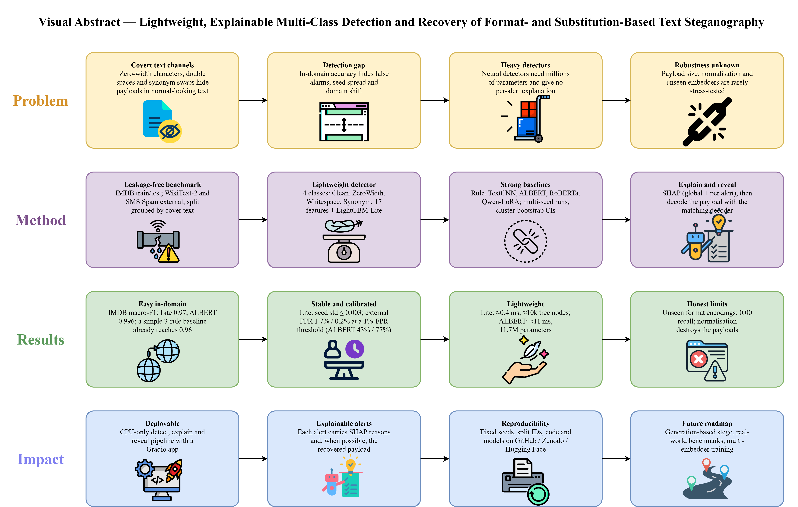

## Pipeline

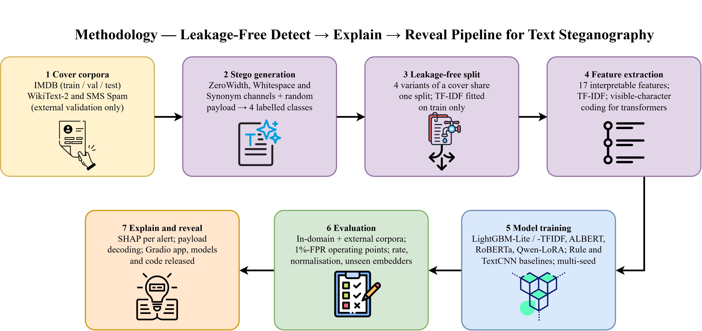

Detect (LightGBM-Lite, 17 interpretable features) → Explain (exact TreeSHAP) → Reveal (decoder of the predicted channel). Baselines: rule baseline, TextCNN, ALBERT, RoBERTa, Qwen2.5-0.5B + LoRA.

## Key findings

### 1. In-domain accuracy is nearly saturated: a 3-rule baseline reaches 0.961

| Model (IMDB test) | Macro-F1 | Size | Latency |
|---|---|---|---|
| Rule baseline | 0.961 | 3 rules + 1 threshold | – |
| **LightGBM-Lite** | 0.968 | 9.8k tree nodes | 0.39 ms (CPU) |
| LightGBM-TFIDF | 0.982 | 20.4k tree nodes | 1.6 ms (CPU) |
| ALBERT | 0.996 | 11.7M params | ≈11 ms (GPU, batched) |

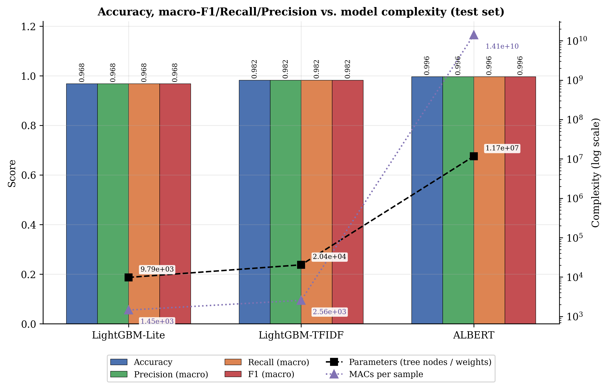

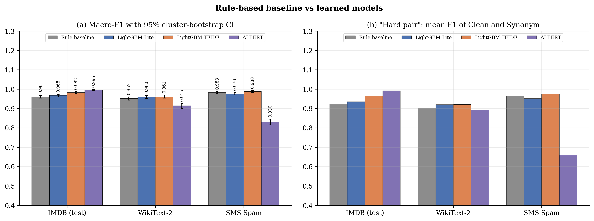

Errors concentrate in the Clean-vs-Synonym pair; ZeroWidth and Whitespace are solved by every method. Lite's seed std is at most 0.003 (5 seeds).

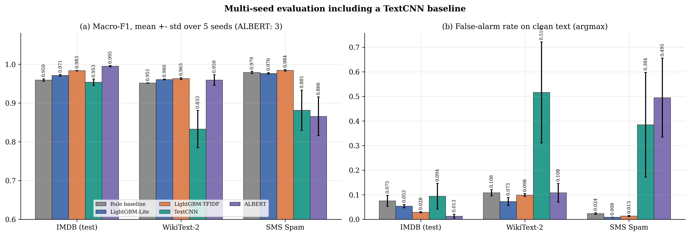

### 2. Under domain shift, the small model stays stable

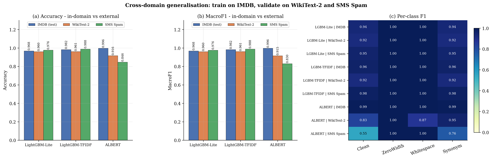

| Macro-F1 (single run) | IMDB | WikiText-2 | SMS Spam |
|---|---|---|---|
| LightGBM-Lite | 0.968 | 0.960 | 0.976 |
| LightGBM-TFIDF | 0.982 | 0.961 | 0.988 |
| ALBERT | 0.996 | 0.915 | 0.830 |

Note: ALBERT's WikiText-2 result is seed-dependent (mean 0.959 over 3 seeds); its SMS Spam result is poor for every seed (0.866 ± 0.050).

### 3. Fixed operating point: false alarms are where models differ

With the threshold set once on IMDB (1% FPR) and applied unchanged to the external corpora:

| False-positive rate on clean text | WikiText-2 | SMS Spam |
|---|---|---|
| **LightGBM-Lite** | **1.7%** | **0.2%** |
| LightGBM-TFIDF | 7.6% | 1.1% |
| ALBERT | 43% | 77% |

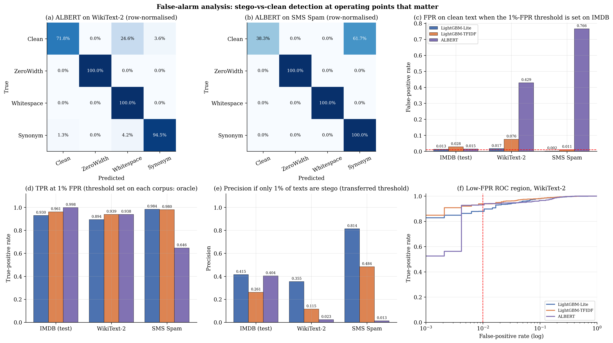

Even a well-behaved detector gives low precision when stego text is rare (1% prevalence: Lite 0.42 on IMDB), so alerts need a second check, which the decoder provides (see 6).

### 4. Larger models help on hard cases, not on calibration

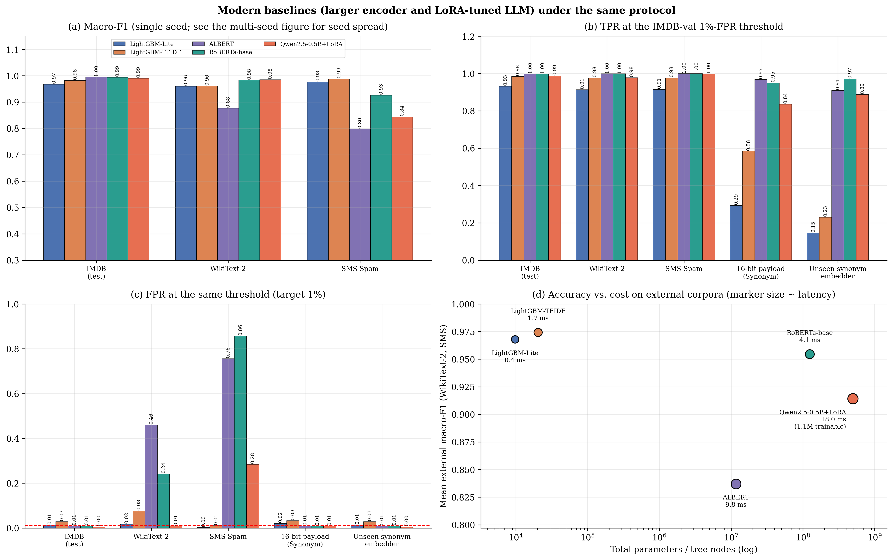

RoBERTa and Qwen-LoRA are better on WikiText-2 (macro-F1 0.984 / 0.985) but not on SMS Spam (0.857 / 0.844). They are clearly better on short payloads (16-bit Synonym TPR 0.93 / 0.84 vs 0.29 for Lite) and on an unseen synonym embedder (0.97 / 0.89 vs 0.15). Lite is the choice for known channels, long payloads, and shifted registers at a fixed threshold.

### 5. Limits we report openly

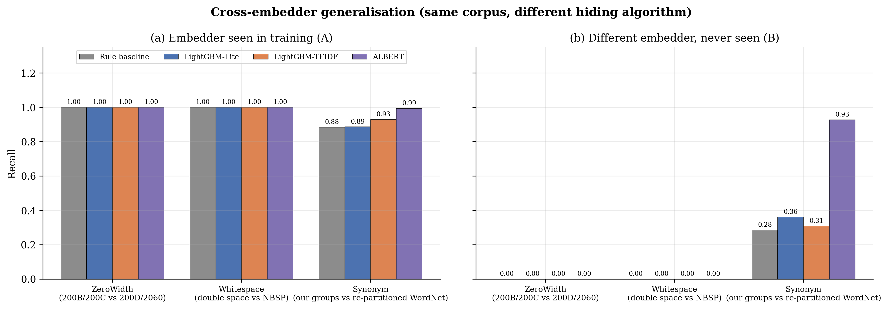

- **Unseen format encodings are missed by every model (recall 0.00).** Add a deterministic pre-filter for unexpected format characters and non-standard spaces.

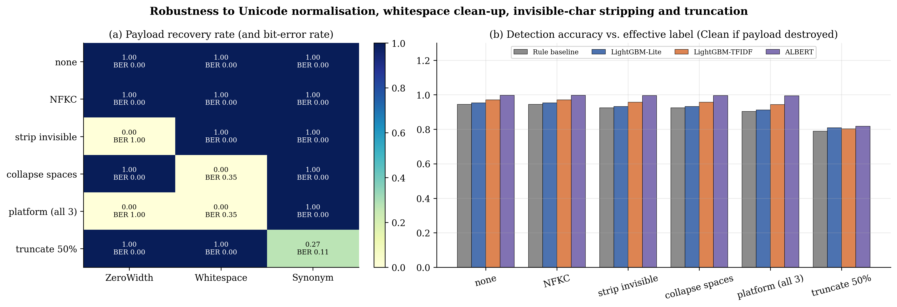

- **Platform processing destroys payloads:** NFKC changes nothing, stripping invisible characters kills ZeroWidth, collapsing whitespace kills Whitespace; Synonym survives but is harder to detect at low rate.

### 6. Every alert is explained and verified

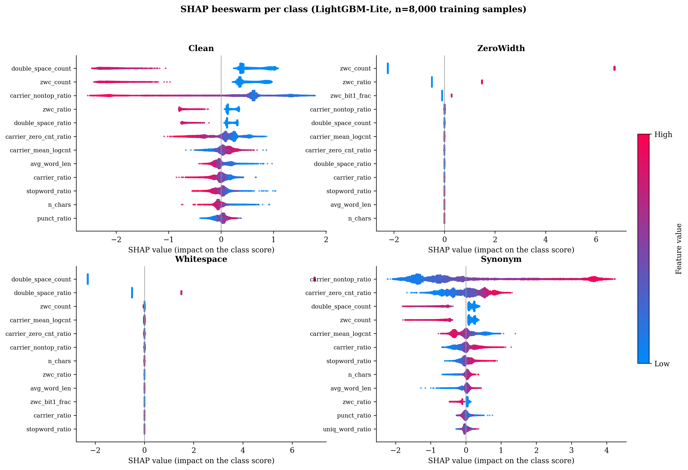

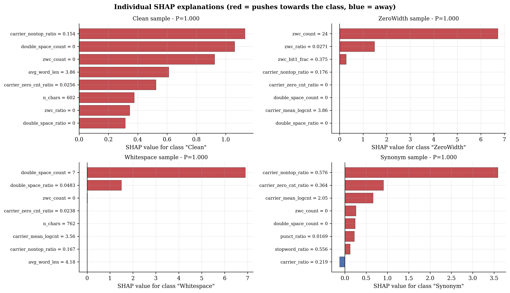

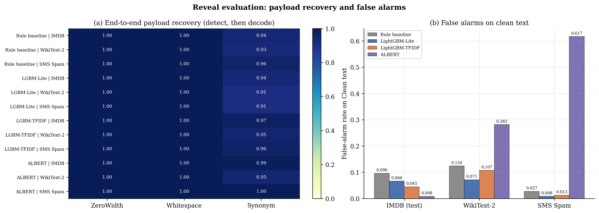

When the class is known, the decoders recover **100%** of payloads. A decoded payload is strong evidence: at most 0.21% of clean texts end up with a revealed payload for any model and corpus.

## Use

```python
from detector import StegoDetector
det = StegoDetector('.', use_albert=False)      # LightGBM-Lite + exact TreeSHAP, CPU, ~ms
print(det.analyze(text))                         # label, probs, revealed payload, top SHAP features
```

Local app: `pip install -r requirements.txt && python app.py` (set `USE_ALBERT=1` for the ALBERT / ensemble modes).

## Repository

| Path | Content |
|---|---|
| `figure/` | All figure (PNG 300 dpi + vector PDF) |
| `csvs/` | Result tables (baseline CIs, multi-seed, external validation, false-alarm calibration, cross-embedder, robustness, reveal, modern baselines) |
| `stego_core.py` | Embedders, decoders, and the 17 features |
| `detector.py`, `app.py` | Detect → Explain → Reveal pipeline and Gradio demo |

## Scope and limitations

- Three simple, known, reversible channels with random 16-40-bit payloads; embedders are ours.
- Reveal decodes only the implemented channels; detection is blind/statistical.
- Synonym features use the same WordNet-based group index as the embedder (Lite's Synonym recall drops to 0.36 with a different partition).
- No generation-based steganography and no adaptive adversary.
- Three English corpora; ALBERT has 3 seeds, RoBERTa and Qwen one.

## Citation

If you use this work, please cite the accompanying paper (details to be added after publication).
